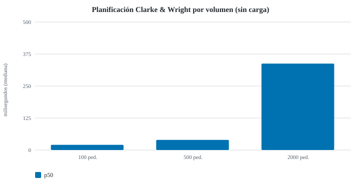
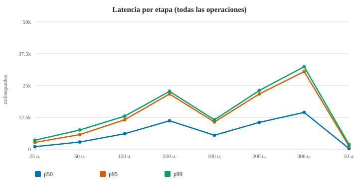
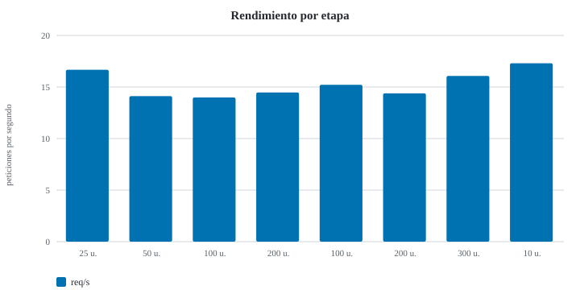
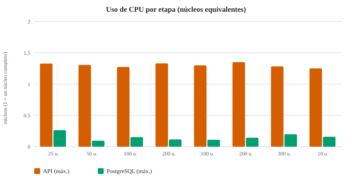

# Reporte no funcional — volumen, carga y estrés (Issue #15)

Ejecutado el 2026-11-04 sobre el commit `52dbc9591a16`.

> Este reporte **no define umbrales de aprobación**: presenta mediciones reales y las limitaciones del ambiente. Los números solo son comparables con corridas del mismo ambiente.

## 1. Ambiente

| Elemento | Valor |
| --- | --- |
| Sistema | Windows_NT 10.0.26200 (x64) |
| CPU | Intel(R) Core(TM) i9-14900HX (32 hilos) |
| Memoria | 31.7 GB |
| Node.js | v26.11.1 |
| API | node dist/main.js (un solo proceso, sin clúster) |
| Base de datos | postgres:16-alpine (Docker, contenedor desechable, tmpfs) |
| Generador de carga | apache-jmeter-5.6.3 |
| Volumen bajo carga | 2000 pedidos |
| Limpieza verificada | sí (0 filas marcadas) |

**Limitación:** API, PostgreSQL, JMeter y el monitor comparten la misma laptop; JMeter compite por CPU con la API. Todo fue en `127.0.0.1` con una base desechable; no se tocó el VPS público ni datos reales.

## 2. Metodología

- **Datos:** semilla fija; mismos pedidos en cada corrida (huella SHA-256 en la tabla de volumen). Todo lo creado lleva la marca `PERF` y se elimina al final con verificación.
- **Volumen:** se siembran 100, 500 y 2000 pedidos y se mide la planificación Clarke & Wright (`GET /route-proposals`) sin otra carga, repetida varias veces.
- **Carga:** JMeter en modo no GUI con 25, 50 y 100 usuarios concurrentes, y 200 porque los recursos lo permitieron (60 s por etapa), mezcla aleatoria uniforme de 5 operaciones con 0–300 ms de reflexión.
- **Estrés:** escalones de +100 usuarios hasta el máximo o hasta un **límite seguro** (tasa de errores > 50 %, memoria de la API > 3000 MB o p95 > 30 s). Esos límites protegen el equipo; no son criterios de aprobación.
- **Recuperación:** tras el estrés, una carga baja de 10 usuarios para comparar contra las latencias de reposo.
- **Métricas:** p50/p95/p99 por rango más cercano, rendimiento = peticiones / ventana medida, errores = respuestas no 2xx; CPU y memoria de la API y de PostgreSQL cada ~2 s.

## 3. Volumen (sin carga concurrente)

| Pedidos | Siembra (s) | Planificación p50 (ms) | Planificación máx. (ms) | Salidas propuestas | Salidas teóricas ×4 | Listado ADMIN (ms) | Huella |
| --- | --- | --- | --- | --- | --- | --- | --- |
| 100 | 0.4 | 20 | 42 | 26 | 25 | 12 | `703324b68f51` |
| 500 | 1.1 | 40 | 45 | 125 | 125 | 10 | `0c575b96e6e8` |
| 2000 | 3.6 | 338 | 365 | 501 | 500 | 10 | `9bff21a2f66d` |



## 4. Carga, estrés y recuperación

| Etapa | Usuarios | Peticiones | req/s | p50 (ms) | p95 (ms) | p99 (ms) | Errores | API CPU máx. (núcleos) | API RSS máx. (MB) | BD CPU máx. (núcleos) | Conexiones BD máx. |
| --- | --- | --- | --- | --- | --- | --- | --- | --- | --- | --- | --- |
| carga-25 | 25 | 1024 | 16.7 | 984 | 2667 | 3509 | 0 % | 1.33 | 524 | 0.26 | 13 |
| carga-50 | 50 | 877 | 14.1 | 2808 | 5732 | 7542 | 0 % | 1.31 | 553 | 0.1 | 11 |
| carga-100 | 100 | 923 | 14 | 6059 | 11560 | 12975 | 0 % | 1.27 | 626 | 0.15 | 11 |
| carga-200 | 200 | 1058 | 14.5 | 11160 | 21677 | 22719 | 0 % | 1.33 | 724 | 0.12 | 11 |
| estres-100 | 100 | 775 | 15.2 | 5467 | 10673 | 11505 | 0 % | 1.3 | 673 | 0.11 | 11 |
| estres-200 | 200 | 862 | 14.4 | 10522 | 21671 | 23054 | 0 % | 1.35 | 750 | 0.14 | 11 |
| estres-300 | 300 | 1025 | 16.1 | 14450 | 30492 | 32400 | 0 % | 1.28 | 802 | 0.2 | 11 |
| recuperacion-10 | 10 | 524 | 17.3 | 247 | 1195 | 1814 | 0 % | 1.25 | 708 | 0.16 | 11 |







### Saturación y límites

- **Saturación observada:** en `carga-50`, el rendimiento (14.1 req/s) casi no crece frente al mejor anterior (16.7 req/s).
- **Parada por límite seguro:** `estres-300` — p95 30492 ms > 30000 ms.
- **Recuperación:** con 10 usuarios, p95 1195 ms y 0 % de errores tras el estrés (la carga más baja, 25 usuarios, tuvo p95 2667 ms).

### Latencia p95 por operación (ms)

| Operación | carga-25 | carga-50 | carga-100 | carga-200 | estres-100 | estres-200 | estres-300 | recuperacion-10 |
| --- | --- | --- | --- | --- | --- | --- | --- | --- |
| GET catalogo publico | 1651 | 2743 | 4802 | 6975 | 3712 | 6996 | 9526 | 1031 |
| GET mis pedidos CLIENT | 1459 | 3343 | 6976 | 11502 | 5622 | 12128 | 16309 | 632 |
| GET pedidos ADMIN paginado | 1895 | 4767 | 9810 | 16385 | 8132 | 16740 | 24454 | 729 |
| GET propuesta de rutas Clarke-Wright | 2231 | 5032 | 10113 | 16714 | 8308 | 16933 | 24653 | 1343 |
| POST crear pedido CLIENT | 3509 | 7542 | 12975 | 22715 | 11276 | 23024 | 32400 | 1792 |

## 5. Experimento de control: la misma carga sin la propuesta de rutas

Para comprobar la causa del estancamiento se repitieron las etapas de 25, 50 y 100 usuarios quitando solo `GET /route-proposals` de la mezcla (mismo commit, mismo ambiente, mismo volumen de 2000 pedidos). No es una corrección del sistema: es un diagnóstico.

| Usuarios | Con planificación: req/s | p95 (ms) | Sin planificación: req/s | p95 (ms) |
|---|---|---|---|---|
| 25 | 16.7 | 2667 | 106.6 | 139 |
| 50 | 14.1 | 5732 | 100.2 | 658 |
| 100 | 14.0 | 11560 | 88.9 | 1796 |

Sin la planificación, con 25 usuarios el rendimiento es 6.4 veces mayor y el p95 pasa de 2667 ms a 139 ms. Aun así el sistema vuelve a estancarse cerca de 107 req/s: el techo pasa de unas 15 a unas 100 req/s, pero sigue siendo un solo núcleo.

## 6. Hallazgos

| ID | Severidad | Hallazgo | Evidencia |
|---|---|---|---|
| P-1 | Alta | **La propuesta de rutas bloquea al resto de la API.** El cálculo Clarke & Wright es síncrono y consume ~340 ms de CPU con 2000 pedidos; como Node atiende todo en un hilo, mientras se calcula, el catálogo público, el listado de pedidos y las compras esperan. Con 25 usuarios el p95 general es de 2667 ms; sin esa operación baja a 139 ms | Secciones 3, 4 y 5 |
| P-2 | Alta | **La API se satura con un solo núcleo.** En todas las etapas la API usa ~1,0–1,3 núcleos de 32 (corre como un único proceso) mientras PostgreSQL usa menos de 0,3 núcleos y ~11–13 conexiones. El rendimiento queda plano en ~14–17 req/s con planificación y ~89–107 req/s sin ella | Tablas de la sección 4 y 5 |
| P-3 | Media | **Sin contrapresión: la latencia crece en lugar de rechazar.** De 25 a 300 usuarios hubo 0 % de errores, pero el p95 pasó de ~2,7 s a ~30,5 s. El tiempo de respuesta crece de forma proporcional a los usuarios (con 100 usuarios, ~7 s por petición a ~14 req/s). Un cliente real con tiempo de espera habitual de decenas de segundos recibiría fallos que el servidor no registra como error | Sección 4 |
| P-4 | Informativo | **La base de datos no es el cuello de botella** en estos escenarios: PostgreSQL nunca superó 0,3 núcleos en las etapas de la corrida completa | Sección 4 |
| P-5 | Informativo | **Recuperación inmediata.** Tras 300 usuarios, con 10 usuarios el p95 fue de 1195 ms y 0 % de errores; no quedaron colas ni degradación residual | Sección 4 |
| P-6 | Informativo | **Escala de la planificación.** 100 pedidos: 20 ms; 500 pedidos: 40 ms; 2000 pedidos: 338 ms. De 500 a 2000 pedidos (×4) el tiempo crece ~×8, no ×4 | Sección 3 |
| P-7 | Informativo | **500 salidas para 2000 pedidos:** la planificación propuso 501 salidas de hasta cuatro paradas (teórico de cuatro en cuatro: 500); con 100 pedidos propuso 26 (teórico 25). Una salida adicional aparece cuando un grupo no se completa de cuatro | Sección 3 |

## 7. Recomendaciones

Son propuestas para decidir con el equipo; la recomendación 1 se aplicó en este PR (ver sección 10); el resto sigue pendiente y no hay un umbral aprobado contra el cual medirlas.

1. **Sacar el cálculo de rutas del hilo principal** (hilo de trabajo o tarea en segundo plano) y/o **guardar la propuesta** por día y zona mientras no cambien los pedidos. Es la mejora con mayor efecto medido (P-1).
2. **Ejecutar más de un proceso de la API** (clúster o varias instancias) tras confirmar que el estado en memoria, como las conexiones en tiempo real, se puede compartir (P-2).
3. **Definir tiempos máximos de respuesta y un límite de peticiones simultáneas** para rechazar a tiempo con un error claro en vez de acumular espera (P-3).
4. **Repetir la corrida en el hardware del servidor de destino**, en un entorno aislado, antes de fijar umbrales; estas cifras son de una laptop de 32 hilos y no se pueden extrapolar.
5. Tras aplicar cualquier otra mejora, **repetir este mismo plan con el mismo comando** para el re-test (`pnpm perf:run`).

## 8. Limitaciones y riesgos conocidos

- API, PostgreSQL, JMeter y el monitor comparten una sola laptop; JMeter compite por CPU. A ~100 req/s ese efecto es pequeño, pero no es cero.
- Los 32 hilos del equipo hacen que el porcentaje total de CPU sea engañoso: por eso se informa en **núcleos equivalentes**.
- Una única corrida por escenario: no se calcularon intervalos de confianza. Las diferencias pequeñas entre etapas no deben interpretarse.
- La carga de 200 usuarios y el estrés hasta 300 se ejecutaron porque los recursos lo permitieron; el escalón de 400 no corrió porque el límite seguro de p95 > 30 s se activó en 300.
- Las compras de prueba crean pedidos de otro día (`2030-03-01`) para no alterar el volumen que se planifica; el catálogo de carga son 50 productos sintéticos.
- No se probó la base de datos real ni el servidor público, por diseño.

## 9. Reproducir

```bash
pnpm build
pnpm perf:run --jmeter <ruta-a-jmeter.bat> --include-200 --max-users 400
pnpm perf:report test-results/perf/<corrida>/results.json docs/perf
```

Requiere Docker y JMeter 5.6.3 (el script no lo instala). Solo corre contra una base local desechable.

## 10. Re-test tras la corrección de P-1

Se aplicó la corrección de P-1 (commit `53d6ed9`: cálculo de rutas en un worker thread, memoizado por contenido y con peticiones idénticas unificadas) y se repitió **el mismo plan y el mismo comando**. Detalle y gráficos: [`retest/REPORT.md`](retest/REPORT.md); datos crudos: `data/retest-after-p1.json`.

| Etapa | req/s antes | req/s después | p95 antes (ms) | p95 después (ms) | Errores |
|---|---|---|---|---|---|
| carga-25 | 16,7 | 48,7 | 2667 | 784 | 0 % |
| carga-50 | 14,1 | 49,9 | 5732 | 1565 | 0 % |
| carga-100 | 14,0 | 46,0 | 11560 | 3230 | 0 % |
| carga-200 | 14,5 | 48,0 | 21677 | 6311 | 0 % |
| estres-200 | 14,4 | 29,6 | 21671 | 13015 | 0 % |
| estres-300 | 16,1 | 44,1 | 30492 (parada por límite) | 9568 | 0 % |
| estres-400 | no corrió | 38,8 | — | 15452 | 0 % |
| recuperacion-10 | 17,3 | 28,8 | 1195 | 424 | 0 % |

**Lectura**
- El rendimiento sube unas 3 veces (de ~14–17 a ~46–50 req/s) y el p95 baja unas 3,5 veces con 25–200 usuarios. Con la corrección el escalón de 300 usuarios ya no activa el límite seguro y el de 400 llegó a correr.
- **No alcanza el máximo del experimento de control** (~107 req/s sin planificación): la API sigue usando ~1,1 núcleos, o sea que el hilo principal continúa saturado. Lo que queda por petición es la consulta de ~2000 pedidos, la evaluación de elegibilidad, armar y serializar la respuesta con 501 propuestas y copiar el resultado de la caché. P-2 (un solo núcleo) sigue abierto y es el siguiente paso.
- `estres-200` es un valor atípico (29,6 req/s, p95 13 s) con una sola corrida por etapa; no se debe leer como tendencia.
- **Limitación de lo medido:** la carga pide siempre la misma fecha, por lo que casi todas las consultas de rutas salen de la memoización. Esta comparación vale para consultas repetidas; el primer cálculo con datos nuevos ahora corre en el worker (no bloquea), pero su costo no se aisló en esta corrida.
- Estado de los hallazgos: **P-1 mitigado** (medido arriba), P-2 y P-3 siguen abiertos, P-4..P-7 sin cambio.
