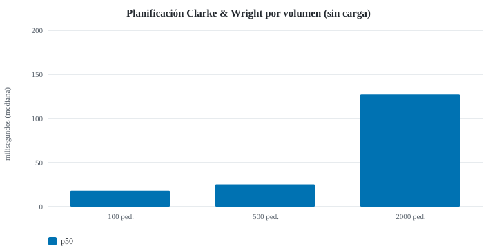
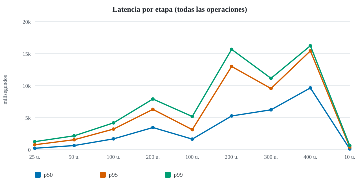
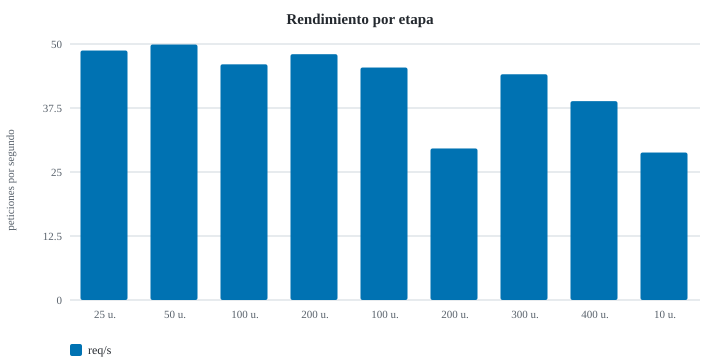
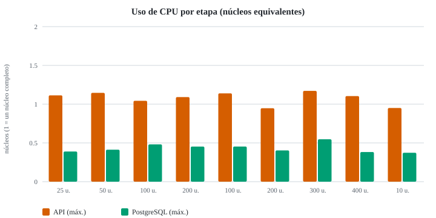

# Reporte no funcional — volumen, carga y estrés (Issue #15)

Ejecutado el 2026-11-04 sobre el commit `53d6ed968cb4`.

> Este reporte **no define umbrales de aprobación**: presenta mediciones reales y las limitaciones del ambiente. Los números solo son comparables con corridas del mismo ambiente.

## 1. Ambiente

| Elemento | Valor |
| --- | --- |
| Sistema | Windows_NT 10.0.26200 (x64) |
| CPU | Intel(R) Core(TM) i9-14900HX (32 hilos) |
| Memoria | 31.7 GB |
| Node.js | v26.11.1 |
| API | node dist/main.js (un solo proceso, sin clúster) |
| Base de datos | postgres:16-alpine (Docker, contenedor desechable, tmpfs) |
| Generador de carga | apache-jmeter-5.6.3 |
| Volumen bajo carga | 2000 pedidos |
| Limpieza verificada | sí (0 filas marcadas) |

**Limitación:** API, PostgreSQL, JMeter y el monitor comparten la misma laptop; JMeter compite por CPU con la API. Todo fue en `127.0.0.1` con una base desechable; no se tocó el VPS público ni datos reales.

## 2. Metodología

- **Datos:** semilla fija; mismos pedidos en cada corrida (huella SHA-256 en la tabla de volumen). Todo lo creado lleva la marca `PERF` y se elimina al final con verificación.
- **Volumen:** se siembran 100, 500 y 2000 pedidos y se mide la planificación Clarke & Wright (`GET /route-proposals`) sin otra carga, repetida varias veces.
- **Carga:** JMeter en modo no GUI con 25, 50 y 100 usuarios concurrentes, y 200 porque los recursos lo permitieron (60 s por etapa), mezcla aleatoria uniforme de 5 operaciones con 0–300 ms de reflexión.
- **Estrés:** escalones de +100 usuarios hasta el máximo o hasta un **límite seguro** (tasa de errores > 50 %, memoria de la API > 3000 MB o p95 > 30 s). Esos límites protegen el equipo; no son criterios de aprobación.
- **Recuperación:** tras el estrés, una carga baja de 10 usuarios para comparar contra las latencias de reposo.
- **Métricas:** p50/p95/p99 por rango más cercano, rendimiento = peticiones / ventana medida, errores = respuestas no 2xx; CPU y memoria de la API y de PostgreSQL cada ~2 s.

## 3. Volumen (sin carga concurrente)

| Pedidos | Siembra (s) | Planificación p50 (ms) | Planificación máx. (ms) | Salidas propuestas | Salidas teóricas ×4 | Listado ADMIN (ms) | Huella |
| --- | --- | --- | --- | --- | --- | --- | --- |
| 100 | 0.4 | 18 | 70 | 26 | 25 | 15 | `703324b68f51` |
| 500 | 1.5 | 25 | 85 | 125 | 125 | 12 | `0c575b96e6e8` |
| 2000 | 7.6 | 127 | 342 | 501 | 500 | 15 | `9bff21a2f66d` |

## 4. Carga, estrés y recuperación

| Etapa | Usuarios | Peticiones | req/s | p50 (ms) | p95 (ms) | p99 (ms) | Errores | API CPU máx. (núcleos) | API RSS máx. (MB) | BD CPU máx. (núcleos) | Conexiones BD máx. |
| --- | --- | --- | --- | --- | --- | --- | --- | --- | --- | --- | --- |
| carga-25 | 25 | 2941 | 48.7 | 233 | 784 | 1268 | 0 % | 1.11 | 588 | 0.39 | 12 |
| carga-50 | 50 | 3013 | 49.9 | 657 | 1565 | 2177 | 0 % | 1.15 | 660 | 0.41 | 11 |
| carga-100 | 100 | 2835 | 46 | 1702 | 3230 | 4197 | 0 % | 1.04 | 766 | 0.48 | 11 |
| carga-200 | 200 | 3022 | 48 | 3472 | 6311 | 7929 | 0 % | 1.09 | 820 | 0.45 | 11 |
| estres-100 | 100 | 2245 | 45.4 | 1662 | 3142 | 5196 | 0 % | 1.14 | 753 | 0.45 | 11 |
| estres-200 | 200 | 1444 | 29.6 | 5283 | 13015 | 15684 | 0 % | 0.95 | 809 | 0.4 | 11 |
| estres-300 | 300 | 2234 | 44.1 | 6241 | 9568 | 11161 | 0 % | 1.17 | 861 | 0.55 | 11 |
| estres-400 | 400 | 2053 | 38.8 | 9663 | 15452 | 16247 | 0 % | 1.1 | 980 | 0.38 | 11 |
| recuperacion-10 | 10 | 863 | 28.8 | 127 | 424 | 656 | 0 % | 0.95 | 971 | 0.37 | 11 |

### Saturación y límites

- **Saturación observada:** en `carga-50`, el rendimiento (49.9 req/s) casi no crece frente al mejor anterior (48.7 req/s).
- No se activó ningún límite seguro: se completaron todos los escalones previstos.
- **Recuperación:** con 10 usuarios, p95 424 ms y 0 % de errores tras el estrés (la carga más baja, 25 usuarios, tuvo p95 784 ms).

### Latencia p95 por operación (ms)

| Operación | carga-25 | carga-50 | carga-100 | carga-200 | estres-100 | estres-200 | estres-300 | estres-400 | recuperacion-10 |
| --- | --- | --- | --- | --- | --- | --- | --- | --- | --- |
| GET catalogo publico | 539 | 774 | 1315 | 2261 | 1071 | 5997 | 3086 | 5856 | 378 |
| GET mis pedidos CLIENT | 389 | 1106 | 2044 | 3909 | 1758 | 9925 | 5646 | 9744 | 319 |
| GET pedidos ADMIN paginado | 577 | 1354 | 2933 | 5664 | 2763 | 12796 | 8073 | 12833 | 269 |
| GET propuesta de rutas Clarke-Wright | 823 | 1451 | 2999 | 6025 | 2841 | 13041 | 8264 | 12886 | 444 |
| POST crear pedido CLIENT | 1189 | 2169 | 4211 | 7929 | 5185 | 15684 | 11158 | 16247 | 544 |

## Contexto de este re-test

Repetición del plan completo (`pnpm perf:run --include-200 --max-users 400`) **después** de corregir P-1 (commit `53d6ed9`: cálculo en worker thread, memoizado por contenido y con peticiones idénticas unificadas). Se compara contra la corrida original de [REPORT.md](../REPORT.md).

**Cuidado al interpretar:** la carga pide siempre la misma fecha, así que casi todas las peticiones de `GET /route-proposals` se sirven de la memoización. Este re-test mide el sistema con la caché caliente; **no** mide el caso de datos nuevos en cada consulta (primer cálculo, ahora en el worker). Una corrida por escenario, mismo equipo compartido.
